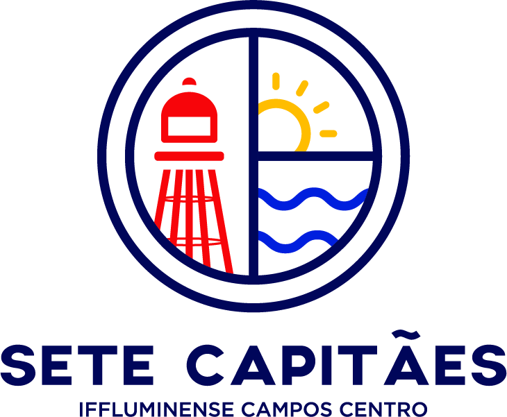
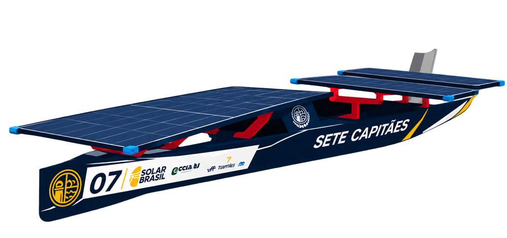

<p align="center"></p>

# SETE CAPITÃES EXPLICA: BARCO IARA 2026

<p align="center"></p>

Aplicação interativa que explica, de forma visual, como funciona o **barco solar Iara** da **Equipe 7 Capitães** (IFFluminense, campus Campos Centro), **campeã nacional do Desafio Solar Brasil 2026**, disputado na Lagoa de Imboassica, em Macaé.

Feita para apresentar o projeto a novos membros e em feiras: o visitante clica no barco, mexe nos controles e vê o efeito na hora.

## O que ela mostra

- Barco clicável com explicação de cada componente (placas, MPPTs, baterias, relé, controlador, motor, painel, direção e casco).
- Caminho da energia animado: geração solar, bateria principal, relé, motor, DC-DC e circuito auxiliar.
- Simulador: irradiância solar, potência no controlador, Dead Man Switch, emergência, carga da bateria auxiliar, limite de 125 A do motor, km/h ou nós.
- Painel do piloto funcional: 6 botões, botão de emergência, volante, display do Epever MT75, rádio VHF e voltímetro.
- Parte mecânica: direção por cremalheira e casco de Divinycell laminado por fora com fibra de vidro e epóxi.
- Telas por setor (geração solar, bateria principal, propulsão, energia auxiliar, painel do piloto, direção e casco) e uma tela geral.

## Como usar

**Online (GitHub Pages):** em *Settings → Pages*, escolha *Deploy from a branch → main → / (root)*. O endereço fica `https://pedrones14.github.io/sete-capitaes-explica-iara/`.

**Offline, sem instalar nada:** baixe o repositório e abra o `index.html` em qualquer navegador, ou dê dois cliques em `Abrir_Iara.bat` (tela cheia, Edge ou Chrome). O arquivo tem imagens e fontes embutidas e não usa internet.

**Programa `.exe` (Windows):** veja a pasta [`electron/`](electron/). Local: `cd electron && npm install && npm run dist`. Na nuvem: aba *Actions → Gerar executavel Windows → Run workflow*. O `.exe` não foi testado pelo autor da documentação; teste em outro computador, sem internet, antes de usar em eventos.

## Estrutura

```
index.html                  aplicação completa (arquivo único, offline)
Abrir_Iara.bat              atalho em tela cheia (Windows)
docs/                       documentação técnica e criativa (PDF)
assets/                     logo e arte do barco usadas neste README
electron/                   projeto para gerar o .exe
.github/workflows/          geração do .exe na nuvem
```

## Observações importantes

- Os números da simulação são **didáticos**. Alguns vêm do manual do motor Navy 6.0 Evo (entrada de 39 a 60 V, cerca de 125 A, 1700 rpm nominais); outros são estimativas a confirmar com dados reais da equipe. A lista completa está na seção 12 do PDF em [`docs/`](docs/Iara-2026-Documentacao-Tecnica.pdf).
- A aplicação é um arquivo HTML único gerado com imagens e fontes embutidas, por isso o `index.html` é grande e não foi pensado para edição manual linha a linha.

## Créditos

Desenvolvido por **Pedro Henrique Nascimento de Oliveira (Pedrones)** · Projeto utilizado no barco Iara em 2026 · Equipe Sete Capitães · IFFluminense Campus Campos Centro.

Aplicação e documentação construídas com apoio do Claude (Anthropic).
"# sete-capitaes-explica-iara" 
