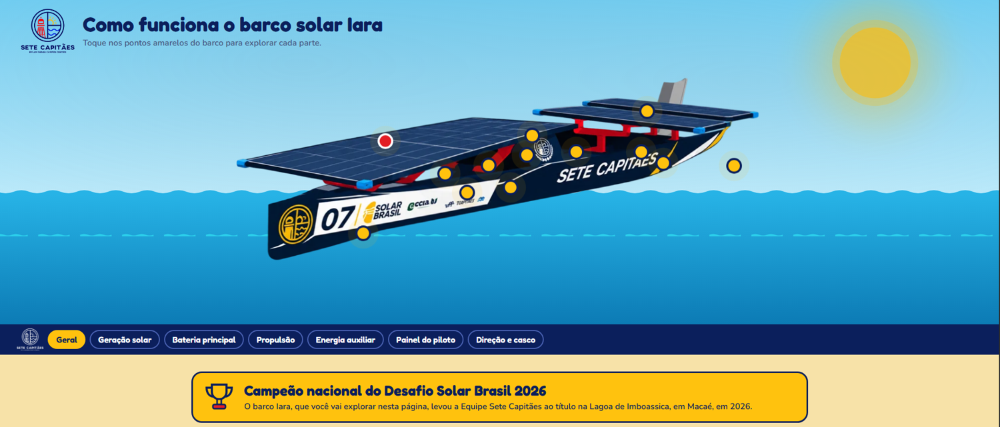
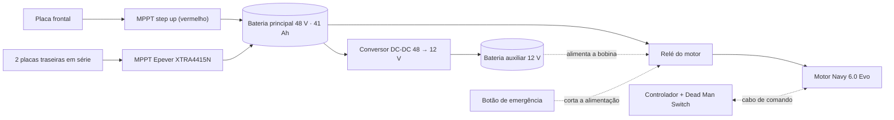

<p align="center"></p>

<h1 align="center">SETE CAPITÃES EXPLICA: BARCO IARA 2026</h1>

<p align="center">
  <b>Campeão nacional do Desafio Solar Brasil 2026</b> · Lagoa de Imboassica, Macaé<br>
  Aplicação interativa que explica, de forma visual, como funciona o barco solar Iara.
</p>

<p align="center">
  
  
  
</p>

<p align="center"></p>

<p align="center"><a href="https://pedrones14.github.io/sete-capitaes-explica-iara/"><b>▶ Abrir a aplicação online</b></a></p>

## Sumário

- [Sobre o projeto](#sobre-o-projeto)
- [Telas e funcionalidades](#telas-e-funcionalidades)
- [O barco em números](#o-barco-em-números)
- [Caminho da energia](#caminho-da-energia)
- [Simulação e proteções](#simulação-e-proteções)
- [Painel do piloto](#painel-do-piloto)
- [Parte mecânica](#parte-mecânica)
- [Como usar](#como-usar)
- [Estrutura do repositório](#estrutura-do-repositório)
- [Decisões técnicas e criativas](#decisões-técnicas-e-criativas)
- [Limitações e premissas](#limitações-e-premissas)
- [Próximos passos](#próximos-passos)
- [Documentação completa](#documentação-completa)
- [Licença e uso das marcas](#licença-e-uso-das-marcas)
- [Créditos](#créditos)

## Sobre o projeto

O **Iara** é o barco solar da **Equipe 7 Capitães**, do Instituto Federal Fluminense (campus Campos Centro). Em 2026 a equipe foi **campeã nacional do Desafio Solar Brasil**, disputado na Lagoa de Imboassica, em Macaé.

Esta aplicação nasceu para **apresentar o projeto a novos membros e em feiras**. Em vez de explicar circuitos só com texto, o visitante clica no barco, mexe nos controles (sol, potência do motor, botões do painel, volante) e vê, na hora, o efeito nas baterias, no motor e nos demais sistemas.

A ideia central: toda explicação técnica vem com uma ação que o usuário pode fazer e uma reação que ele consegue ver.

## Telas e funcionalidades

A barra de telas, fixa no topo, alterna entre uma **tela geral**, com tudo junto, e **telas por setor**. Nelas, os controles e as consequências ficam lado a lado, para você ver o efeito de cada teste sem rolar a página.

| Tela | O que mostra | O que testar |
|---|---|---|
| **Geral** | Barco clicável, caminho da energia, parte mecânica, painel do piloto e simulador numa só página. | Clicar nos pontos amarelos do barco e explorar tudo. |
| **Geração solar** | Placas, MPPTs, geração e carga da bateria. | Mexer no sol e na contatora solar. |
| **Bateria principal** | Bateria de 48 V e 41 Ah, com tensão, corrente e carga. | Combinar sol, potência do motor e DC/DC. |
| **Propulsão** | Motor, hélice, controlador, relé e emergência. | Aumentar a potência, retirar o Dead Man Switch, abrir o relé, acionar a emergência. |
| **Energia auxiliar** | Bateria de 12 V, DC-DC e seus consumos. | Ligar o DC/DC e ver o custo na bateria principal. |
| **Painel do piloto** | Painel funcional com botões, emergência, volante, display, rádio e voltímetro. | Apertar os botões e acompanhar os efeitos ao lado. |
| **Direção e casco** | Direção por cremalheira e camadas do casco. | Girar o volante e ver a haste e a cabeça do motor se moverem. |

Outros recursos:

- Explicação de cada componente ao clicar no barco ou no diagrama.
- Tempo acelerado (1×, 30×, 120× e 600×) para ver a bateria mudar.
- Velocidade em **km/h ou nós**.
- Sol, nuvens e cenário que reagem ao controle de irradiância.
- Tela inicial com a logo, o nome do projeto e o selo de campeão.

## O barco em números

| Componente | Especificação |
|---|---|
| Bateria principal | 48 V, 41 Ah, íons de lítio (≈ 1,97 kWh), em invólucro com dissipadores |
| Bateria auxiliar | 12 V |
| Placas solares | 3 placas, 620 W de geração no total |
| MPPT da placa frontal | Step up (vermelho), entrada 12–60 V |
| MPPT das placas traseiras | Epever XTRA4415N (2 placas em série) |
| Motor | ePropulsion Navy 6.0 Evo, 6 kW, entrada de 39 a 60 V, cerca de 125 A, 1700 rpm nominais |
| Controlador | Evo Remote Control, com Dead Man Switch |
| Conversor DC-DC | Victron Orion-Tr 48/12-30 (isolado, 360 W) |
| Casco | Divinycell laminado por fora com fibra de vidro e resina epóxi |
| Direção | Mecânica, com pinhão, cremalheira, cabos de aço e haste |

## Caminho da energia



- **Geração:** a placa da frente usa o MPPT vermelho, e as duas traseiras, em série, usam o MPPT Epever. Os dois carregam a bateria principal.
- **Propulsão:** a bateria principal alimenta o motor pelo relé. O controlador não fica na linha de potência: ele se liga ao motor por um cabo de comando.
- **Auxiliar:** o DC-DC carrega a bateria de 12 V a partir da principal, quando o piloto liga o botão no painel. A auxiliar alimenta telemetria, rádio, bombas de porão, buzina e a bobina do relé.
- **Emergência:** o botão está ligado direto ao relé e corta a alimentação do motor.

## Simulação e proteções

A simulação é **didática**: simples o bastante para entender, e coerente com o comportamento real.

- **Geração:** depende da irradiância e da eficiência dos MPPTs.
- **Bateria:** a tensão cai conforme a carga e a corrente (há resistência interna).
- **Motor:** a potência pedida no controlador é suavizada no tempo, e a potência real é limitada pela corrente máxima do motor.
- **Bateria cheia:** os MPPTs reduzem a geração para não sobrecarregar.
- **Auxiliar cheia com o DC-DC ligado:** o conversor só repõe o consumo.

| Situação | O que acontece |
|---|---|
| Dead Man Switch retirado | O comando é cortado e o motor para. Para voltar, recoloque a chave e leve a potência a zero. |
| Botão de emergência | O relé abre e o motor perde a alimentação. |
| Relé do motor aberto | O motor não liga, mesmo com potência no controlador. |
| Bateria auxiliar muito baixa | O relé desarma, e rádio, buzina e bombas ficam sem energia. |
| Bateria principal baixa (menos de 42 V) | A potência cai aos poucos, e abaixo de 39 V o motor para. |
| Corrente máxima | A corrente é limitada a cerca de 125 A, então com a bateria pela metade o motor entrega perto de 5,5 kW mesmo com o controlador no máximo. |

## Painel do piloto

| Item | Função |
|---|---|
| Buzina | Soa enquanto o botão é mantido pressionado. |
| Contatora solar | Fechada, as placas carregam as baterias. Aberta, a geração é desconectada. |
| Acionamento DC/DC | Liga o conversor que carrega a bateria auxiliar. |
| Bombas de porão | Expulsam a água do cockpit e da caixa de circuitos. |
| Relé do motor | Libera ou corta a energia do motor. |
| Botão vago | Sem função por enquanto. |
| Emergência | Corta o motor pelo relé. Trava até ser clicado de novo. |
| Volante | Gira ao arrastar, com cerca de 2,5 voltas para cada lado. |
| Display Epever MT75 | Geração das placas traseiras, carga da bateria e energia acumulada. |
| Voltímetro e rádio VHF | Acompanham o circuito de 12 V. |

## Parte mecânica

**Direção.** O volante gira um pinhão que desloca uma cremalheira. A cremalheira movimenta cabos de aço, que correm pela lateral do barco, da proa até a popa, e movem uma haste de metal acoplada à cabeça do motor. A haste se desloca de um lado para o outro e o motor gira junto, mudando a direção do empuxo.

**Casco.** Feito de espuma Divinycell, laminada com fibra de vidro e resina epóxi apenas pela parte externa. Por dentro, a espuma fica sem laminação.

## Como usar

**Online:** abra https://pedrones14.github.io/sete-capitaes-explica-iara/ no navegador. Não precisa instalar nada.

**Offline, sem instalar nada:** baixe o repositório e abra o `index.html` em qualquer navegador, ou dê dois cliques em `Abrir_Iara.bat` (tela cheia, Edge ou Chrome). O arquivo tem imagens e fontes embutidas e não usa internet.

**Programa `.exe` (Windows):** veja a pasta [`electron/`](electron/). O `.exe` não foi testado pelo autor. Teste em outro computador, sem internet, antes de usar em eventos.

### Para quem mantém o projeto

- **Publicar a versão online:** em *Settings → Pages*, escolha *Deploy from a branch → main → / (root)*. Isso é feito uma única vez, pelo dono do repositório.
- **Gerar o `.exe` localmente:** `cd electron && npm install && npm run dist`.
- **Gerar o `.exe` na nuvem:** aba *Actions → Gerar executavel Windows → Run workflow*, e baixe o arquivo em *Artifacts*.

## Estrutura do repositório

```
index.html                  aplicação completa (arquivo único, funciona offline)
Abrir_Iara.bat              atalho em tela cheia para Windows
docs/                       documentação técnica e criativa (PDF)
assets/                     logo, arte do barco e captura de tela usadas neste README
electron/                   projeto para gerar o .exe
.github/workflows/          geração do .exe na nuvem
```

## Decisões técnicas e criativas

- **Arquivo único:** HTML, CSS e JavaScript sem bibliotecas, com imagens (WebP) e fontes embutidas. É fácil de levar, publicar e usar offline.
- **Gráficos em SVG:** o diagrama, a direção, o casco e o painel do piloto são desenhados por código e reagem à simulação.
- **Imagens sem fundo:** as artes minimalistas da equipe foram recortadas para se integrarem ao cenário de sol, mar, água e areia.
- **Cores institucionais:** amarelo, branco e vermelho em botões, sliders e destaques, com o azul-marinho da logo nos textos.
- **Números estáveis:** formato brasileiro (vírgula decimal), corrente sempre positiva com a indicação de carga ou descarga, e cartões com altura fixa para a página não "pular".
- **Acessibilidade:** pontos e cartões funcionam por teclado, e as animações respeitam a preferência de movimento reduzido do sistema.

A lista completa das decisões está no [PDF da documentação](docs/Iara-2026-Documentacao-Tecnica.pdf).

## Limitações e premissas

Os números da simulação são **ilustrativos**. Alguns vêm do manual do motor Navy 6.0 Evo (tensão de entrada, corrente máxima, proteção por subtensão e rotação nominal). Outros são estimativas a confirmar com dados reais da equipe, como a divisão da potência entre as placas, a eficiência dos MPPTs, a capacidade da bateria auxiliar e o ângulo máximo do motor.

O `index.html` é um arquivo gerado, grande e com imagens em base64, e não foi pensado para edição linha a linha.

## Próximos passos

- Usar os modelos 3D (STEP) do motor e do controlador, animando a cabeça do motor e a manete.
- Simular a marcha à ré (o manual indica máximo de 3 kW em ré).
- Trocar as estimativas por medições reais da equipe.
- Detalhar outros consumos do circuito de 12 V.

## Documentação completa

O PDF [`docs/Iara-2026-Documentacao-Tecnica.pdf`](docs/Iara-2026-Documentacao-Tecnica.pdf) reúne todas as informações e decisões técnicas e criativas, as fórmulas da simulação e a lista de premissas.

## Licença e uso das marcas

Este repositório ainda não define uma licença. A logo da Sete Capitães e os logos dos patrocinadores que aparecem na arte do barco pertencem à equipe e aos respectivos patrocinadores, e não são cobertos por nenhuma licença do código.

## Créditos

Desenvolvido por **Pedro Henrique Nascimento de Oliveira (Pedrones)** · Projeto utilizado no barco Iara em 2026 · Equipe Sete Capitães · IFFluminense Campus Campos Centro.

Aplicação e documentação construídas com apoio do Claude (Anthropic).
